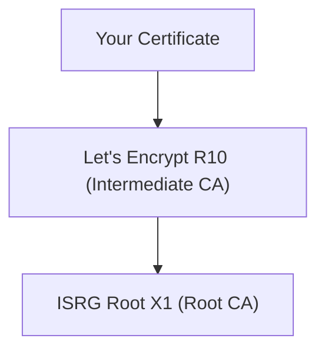

# Let's Encrypt Certificate Chain (R10)

If your certificate is issued using an **RSA key**, it will be signed by the **R10 intermediate certificate**,
which is itself signed by **ISRG Root X1**.

- **R10** is an RSA `2048` intermediate.
- **ISRG Root X1** is a widely trusted RSA `4096` root.
- This chain ensures maximum compatibility across browsers and systems.

No cross-signing applies here — **only this single chain is valid** for RSA certificates.
